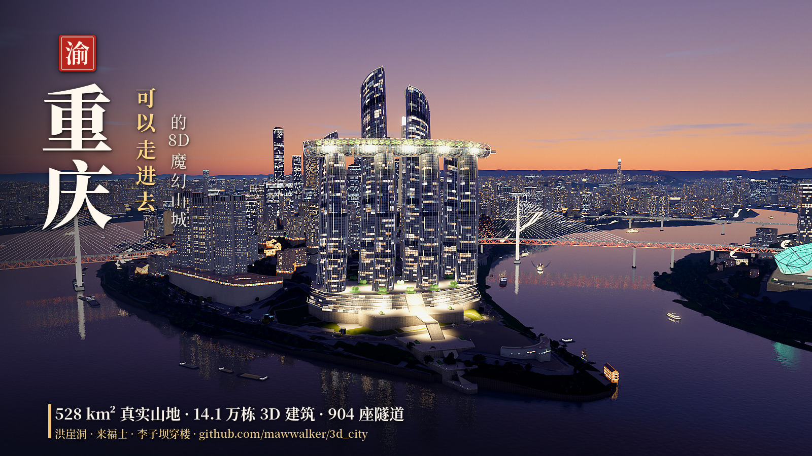
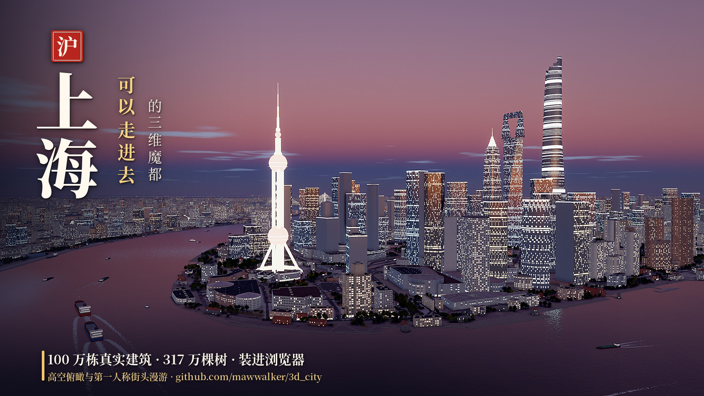
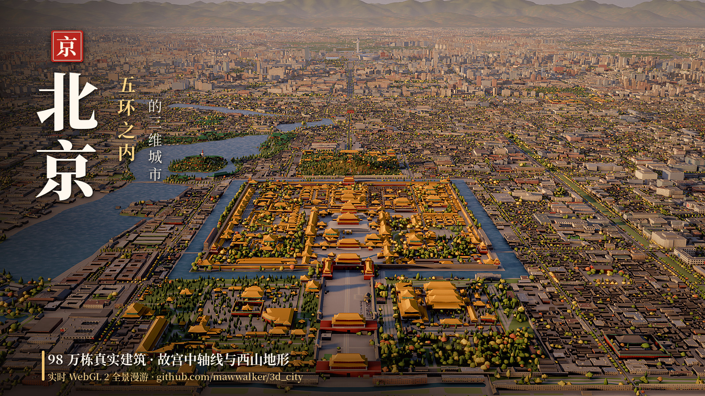

# 3D City · 中国三城 WebGL 2 实时三维城市全景

> **纯静态 · 零后端 · 零外部 CDN · 打开浏览器即可漫游的真实 WGS-84 三维中国城市**
>
> **Chongqing 3D (8D Mountain City Flagship) · Shanghai 3D · Beijing 3D** — Three interactive, pure-static WebGL 2 3D city explorers built directly from real WGS-84 OpenStreetMap, Copernicus GLO-30 DEM, GlobalBuildingAtlas, and Overture Maps datasets.

---

## 旗舰作品 · 重庆 3D：8D 魔幻山城全景 (`chongqing_3d`)



<!--
  🎥 原生内嵌视频播放槽位（GitHub README 最佳方案）：
  请在 GitHub 网页端编辑本 README.md，直接将本地 `media_for_github_upload/chongqing_github.mp4`（<= 9.5 MB）
  拖拽到此注释下方，GitHub 会自动生成 `https://github.com/user-attachments/assets/...` 原生 <video> 播放器，
  无需跳转 YouTube / Google Drive，在仓库首页直接流畅播放！
-->
> **▶ 实机演示视频（1080p 确定性逐帧录制）**：

https://github.com/user-attachments/assets/454f6675-ece0-48a9-8cb9-e8d14f48a4cf

**核心亮点（真实 8D 山城 + 建筑级实景建模 + 250+ FPS）：**
- **真三维 8D 山地地形**：以解放碑（`106.573357°E, 29.560101°N`，真实 WGS-84）为原点，覆盖 `24 km × 22 km`（`528` 张 1 km 瓦片）及 `64 km × 64 km` 远景山脉；核心区采用 **2.5 m Voronoi 道路削平精修 DEM**（`terrain_core.bin`），实现平缓道路台地、清晰堡坎崖壁与长江/嘉陵江两江平面（水高基准 `168 m ASL`），核心车道横坡 `>10°` 仅 `0.29%`。
- **141,090 栋全真 3D 建筑（零重叠 / 零共面闪烁）**：融合 OSM + GlobalBuildingAtlas + Overture 轮廓，逐角采样 DEM 生成真石砌堡坎基础与吊脚楼架空底层（**零悬空**）；`facadeKit.js` 与 `buildingGeom.js` 逐栋生成 3D 商业裙楼、退台塔楼、凹进窗洞与 16 套透视室内房间贴图（`interiors.webp`）、3D 阳台/晾衣架/防盗网/空调外机/落水管、巴渝小青瓦翘角屋顶及山城霓虹店招；全城经过 3 轮 3D 去重与 `0.1 m` 量化锁定（**0 重叠建筑 / 0 共面 Z-fighting 墙面**）。
- **23 处博物馆级重庆地标与跨江桥梁工程**：
  - **渝中与两江核心地标**：洪崖洞 11 层吊脚楼（1F 滨江路直通 11F 沧白路、瀑布、挑檐斗拱、红灯笼夜景）、重庆来福士（8 栋弧形风帆 + 横跨高空水晶连廊）、人民解放纪念碑、国泰艺术中心（140+ 根红黑交错悬挑梁）、重庆 WFC（339 m）、陆海国际中心 Chongqing 100（458 m）、重庆大剧院、重庆市人民大礼堂、重庆科技馆、白象居、魁星楼、十八梯、南山一棵树观景台。
  - **8D 魔幻立体交通与十座跨江大桥**：**李子坝轻轨穿楼**（动态 6 节 CRT 2 号线列车定时从 6–8 层楼体洞口穿出）、**长江索道**（双红白轿厢沿抛物线钢缆实景横渡长江）、**苏家坝 72 m 螺旋立交**、**黄桷湾 5 层 20 匝道立交**、千厮门大桥、东水门大桥、朝天门大桥、菜园坝大桥、石板坡复线桥、黄花园大桥、嘉陵江大桥、渝澳大桥，以及全城 **904 座实体 3D 山体隧道洞门**（石黄隧道、朝天门隧道等）。
- **零穿墙 / 零瞬移的动态城市生态**：全城实景车流（含桥面与山体隧道）、`4,747 km` 零发夹弯/零障碍行人步道（1190 万次 120s 轨迹评测 **0 瞬移、0 凭空消失、0 穿建筑/地标/隧道墙**）、两江游船与货轮、91.6 万棵分种树木、38 层 `1024×1024` PBR 材质阵列、延迟渲染 + 浮点反向深度 + 4 级级联阴影 + 物理大气 + GTAO/TAA/雨夜倒影；RTX 5080 1080p Ultra 实测 **253–299 FPS**。

---

## 三城技术演进对比 · Three-City Evolution (`Beijing → Shanghai → Chongqing`)

| 维度 / Feature | 北京 3D (`beijing_3d`) | 上海 3D (`shanghai_3d`) | 重庆 3D (`chongqing_3d`) ★ 旗舰 |
|---|---|---|---|
| **核心定位** | 五环内外航拍全景城市模型 | 第一人称街头漫步 + 交通仿真 | **8D 立体山城 + 建筑级实景真 3D** |
| **坐标原点 (WGS-84)** | 天安门 | 国际饭店 | 解放碑 (`106.573357°E, 29.560101°N`) |
| **覆盖范围与建筑规模** | 五环内外，约 **98 万**栋建筑 | 全市核心，约 **100 万**栋建筑 | `24×22 km`（528 瓦片）+ `64 km` 山脉，**141,090** 栋真 3D 建筑 |
| **地形与高程** | 30 m 西山/军都山起伏 | 平原 + 路缘 15 cm 高差 + 高架 | **2.5 m 核心道路削平 DEM + 10 m / 100 m 三级山地**（最大落差 513 m） |
| **建筑立面与室内** | 拉伸轮廓 + 程序化窗墙 | 视差窗洞 + 室内映射 + 512 px PBR | **全真 3D 构件（阳台/窗框/防盗网/空调/落水管/石砌堡坎）+ 16 套 512 px 室内房 + 38 层 1024 px PBR + 0 共面 Z-fighting** |
| **地标与立体交通** | 故宫、天坛、国贸 CBD、鸟巢等 | 陆家嘴三件套、外滩、豫园、6 座黄浦江大桥、江船 | **洪崖洞、来福士、李子坝轻轨穿楼、长江索道、大礼堂、大剧院、十八梯、苏家坝、黄桷湾、8 座跨江大桥、904 座 3D 隧道洞门** |
| **动态系统** | 路面着色器车流 + 进近客机 + 四季 | 完整车流仿真 + 路牌 + 317 万棵树 + 行人 + 渡轮 | **立体坡道/隧道车流 + 零瞬移零穿墙行人 + 动态单轨列车 + 过江索道 + 两江游船 + 91.6 万棵树 + 晴/霾/阴/雨夜** |
| **静态站点体积 (`site/`)** | ~43 MB | ~142 MB | ~81 MB（单文件最大 `20 MB`） |
| **本地默认端口** | `8765` | `8766` | `8768` |

---

## 更多城市 · 上海 3D & 北京 3D

### 上海 · 漫步全景 (`shanghai_3d`)



<!-- 拖拽本地 `media_for_github_upload/shanghai_github.mp4` 到 GitHub 网页编辑器此处以启用原生内嵌视频播放 -->
> **▶ 实机演示视频**：

https://github.com/user-attachments/assets/33fcdd23-3774-434d-b3cd-5127fc839d38


### 北京 · 五环之内 (`beijing_3d`)



<!-- 拖拽本地 `media_for_github_upload/beijing_github.mp4` 到 GitHub 网页编辑器此处以启用原生内嵌视频播放 -->
> **▶ 实机演示视频**：

https://github.com/user-attachments/assets/07f8ef2b-21e9-466f-8232-8a44cb3082e6


> **为什么推荐直接拖拽 `media_for_github_upload/*_github.mp4` 到 GitHub README 编辑器？**
> GitHub Markdown 仅对直接拖拽上传到 `github.com/user-attachments/assets/...` 的 MP4（免费账号单文件上限 10 MB）渲染原生 `<video>` 内嵌播放器；YouTube 链接只能显示缩略图跳转，Google Drive 外链无法在 README 中直接播放。本仓库配套的 `media_for_github_upload/*_github.mp4`（已加入 `.gitignore`，不占 Git 历史体积）均严格控制在 **9.5 MB 以内**，直接拖入 GitHub 网页端即可实现三城原生视频直放！

---

## 快速运行 · Quick Start

无需 `npm install`，无需构建工具，克隆仓库后用任意静态 HTTP 服务器即可直接打开（需支持 WebGL 2 与 `DecompressionStream` 的现代浏览器：Chrome / Edge 80+、Firefox 113+、Safari 16.4+）：

```bash
git clone https://github.com/mawwalker/3d_city.git
cd 3d_city

# 1. 运行重庆 3D（旗舰，默认 http://127.0.0.1:8768/）
./chongqing_3d/serve.sh

# 2. 运行上海 3D（默认 http://127.0.0.1:8766/）
./shanghai_3d/serve.sh

# 3. 运行北京 3D（默认 http://127.0.0.1:8765/）
./beijing_3d/serve.sh
```

> 也可直接使用 Python 启动任意一城：`python3 -m http.server 8768 --directory chongqing_3d/site --bind 127.0.0.1`。请勿直接双击 `index.html`（ES Module 与 Web Worker 要求通过 HTTP 协议加载）。

---

## 操作指南 · Controls (Chongqing & Shanghai)

| 按键 / 操作 | 功能 |
|---|---|
| 点击画面 / 按住拖拽 | 锁定鼠标环顾视角（`Esc` 释放），或直接拖拽旋转 |
| `W` `A` `S` `D` / 方向键 | 前后左右移动 |
| `Shift` | 加速（步行冲刺 / 飞行 4× 速） |
| `Space` / `C` 或 `Q` | 步行跳跃；飞行上升 / 下降 |
| `F` | **步行 / 飞行**模式自由切换 |
| `G` | 立即平稳落至脚下地面、桥面或屋顶 |
| 鼠标滚轮 | 调节飞行速度 |
| `M` | 打开全城地图，点击任意点瞬移 |
| 数字键 `1`–`9` | 快速飞往预设地标视角 |
| `H` / `N` | 隐藏界面（截图用）/ 飞行穿墙开关 |
| URL 参数 | `?pos=x,y,z&look=yaw,pitch&mode=walk\|fly&hour=20.5&weather=clear\|haze\|cloudy\|overcast\|rain&q=low\|medium\|high\|ultra&ui=0` |

> 北京 3D 为鸟瞰轨道漫游交互（左键平移、右键旋转俯仰、滚轮缩放、空格自动巡游、`1–9` 切地标），详见 [`beijing_3d/README.md`](beijing_3d/README.md)。

---

## 仓库结构 · Repository Layout

```text
3d_city/
├── chongqing_3d/          # ★ 重庆 8D 魔幻山城 3D（完整静态站点 + GIS/DEM 管线 + 评测/制片工具）
│   ├── site/              #   纯静态前端（index.html, src/, data/, assets/, vendor/）
│   ├── pipeline/          #   Python WGS-84 GIS / 2.5m DEM / 瓦片 / PBR 贴图重建管线
│   ├── tools/             #   无头 Chromium 自动化截图、零闪烁/零瞬移审计与电影录制脚本
│   └── serve.sh           #   一键本地启动脚本（端口 8768）
├── shanghai_3d/           # 上海漫步全景 3D（site/ + pipeline/ + tools/ + serve.sh）
├── beijing_3d/            # 北京五环之内 3D（site/ + pipeline/ + tools/ + serve.sh）
├── docs/covers/           # 三城 1600×900 高清封面海报
├── LICENSE                # Apache License 2.0（原创源码）+ CC BY 4.0（文档封面）+ 上游开源数据许可说明
├── NOTICE                 # Apache-2.0 第 4(d) 条强制署名声明（含作者与上游数据署名）
└── THIRD_PARTY_NOTICES.md # 完整第三方开源数据、贴图、字体与依赖库署名清单
```

---

## English Summary

**3D City (`mawwalker/3d_city`)** is a collection of three pure-static, zero-backend, zero-CDN **WebGL 2** real-time 3D city explorers built from genuine **WGS-84** open geographic data:

- **Chongqing 3D (`chongqing_3d`, Flagship)**: Full `24×22 km` 8D Mountain City (`528` streamed `'CQT2'` tiles + `64 km` backdrop) featuring a **2.5 m Voronoi road-benched Copernicus DEM**, **141,090 zero-overlap true-3D buildings** with hillside retaining plinths & 16 parallax furnished interior rooms, **38×1024px PBR materials**, **23 hand-crafted hero landmarks & cross-river bridges** (Hongyadong, Raffles City, Liziba CRT Line 2 monorail passing through the building, Yangtze River Cableway, Sujiaba 72 m spiral, Huangjuewan 5-level interchange, 8 river bridges, and **904 3D mountain tunnel portals**), live traffic & teleport-free/clip-free pedestrians, running at **250–300 FPS** at 1080p Ultra.
- **Shanghai 3D (`shanghai_3d`)**: First-person walkable metropolis (~1M buildings, 3.17M trees, full lane-accurate traffic simulation, Huangpu River bridges & boats, Lujiazui skyline).
- **Beijing 3D (`beijing_3d`)**: Orbit-camera 3D model inside/around the Fifth Ring Road (~980k buildings, Western Hills DEM, imperial landmarks, seasonal autumn/snow/summer modes).

Run any city locally with `./chongqing_3d/serve.sh`, `./shanghai_3d/serve.sh`, or `./beijing_3d/serve.sh`.

---

## 开源许可与强制署名 · License & Attribution

本项目全面拥抱开放共享与规范署名，**允许自由用于开源、研究、二次开发及商业项目**，同时严格要求保留作者与上游开放数据的署名声明：

- **原创源码与三维建模代码**（`*/pipeline/`、`*/site/src/`、`*/tools/`）：采用 **[Apache License, Version 2.0](./LICENSE)**（`Apache-2.0`）并附带强制署名文件 **[`NOTICE`](./NOTICE)**（依据 Apache-2.0 第 4(d) 条，所有衍生作品、修改版本及线上部署站点均须保留 `NOTICE` 文件及 `3D City © mawwalker` 与上游地图数据的可见署名）。
- **文档与封面视觉素材**（`docs/`、`README.md`）：采用 **CC BY 4.0**（署名即可自由使用与商用）。
- **上游开放地理数据与第三方依赖**：
  - `*/site/data/` 中的衍生地理数据与 `*/site/assets/` 中的 CC0 PBR 材质继续遵循各自上游开源许可（**OpenStreetMap 数据遵循 ODbL 1.0**、**GlobalBuildingAtlas / 3D-GloBFP / CMAB / CBMF / SinoLC-1 / Canopy 遵循 CC BY 4.0**、**Copernicus DEM 遵循 Copernicus 开放许可**、**ambientCG / Poly Haven 遵循 CC0 1.0**）。
  - `*/site/vendor/` 中的 `Three.js`、`three-mesh-bvh` 遵循 **MIT**，`earcut` 遵循 **ISC**；北京站点子集字体（思源宋体）遵循 **SIL OFL 1.1**。

---

## 第三方数据署名 · Data Attribution

- **Map data**: `© OpenStreetMap contributors` ([ODbL 1.0](https://www.openstreetmap.org/copyright)), extracts via Geofabrik.
- **Elevation (DEM)**: **Copernicus DEM GLO-30** (`© DLR e.V. 2010-2014 and © Airbus Defence and Space GmbH 2014-2018 provided under COPERNICUS by the European Union and ESA; all rights reserved`).
- **Building & Land-Cover Datasets**: GlobalBuildingAtlas LoD1 (CC BY 4.0), Overture Maps (ODbL / CDLA-Permissive-2.0 / Shi et al. CC BY 4.0), 3D-GloBFP (CC BY 4.0), CMAB (CC BY 4.0), CBMF (CC BY 4.0), SinoLC-1 (CC BY 4.0), Meta/WRI High Resolution Canopy Height (CC BY 4.0).
- **Textures & Libraries**: ambientCG & Poly Haven (CC0 1.0), Three.js (MIT), three-mesh-bvh (MIT), earcut (ISC), SIL OFL 1.1 fonts.

完整署名与免责声明请查阅 [`THIRD_PARTY_NOTICES.md`](./THIRD_PARTY_NOTICES.md)。本作品为艺术与技术实验可视化，所有坐标采用真实 WGS-84，**不可用于导航、测绘或工程用途**。
